<div align="center">

# Brainiacs Collection

A curated personal collection of high-resolution wallpapers, pixel art, anime aesthetics, and scenic backgrounds.

<p align="center">
  <a href="https://github.com/Brainitech/Brainiacs_Collection"></a>
  <a href="#gallery"></a>
</p>

</div>

## Clone

```bash
# Clone the repository
git clone https://github.com/Brainitech/Brainiacs_Collection.git

# Enter directory
cd Brainiacs_Collection
```

## Gallery

> Click on any preview to open and view the full-resolution wallpaper.

<table>
  <tr>
    <td align="center" width="25%" valign="top">
      <a href="Wallpapers/2b.jpg">
        <br />
        <sub><b>2b</b></sub>
      </a>
    </td>
    <td align="center" width="25%" valign="top">
      <a href="Wallpapers/2B_Ruins.jpg">
        <br />
        <sub><b>2B Ruins</b></sub>
      </a>
    </td>
    <td align="center" width="25%" valign="top">
      <a href="Wallpapers/8bit_citylane_px.png">
        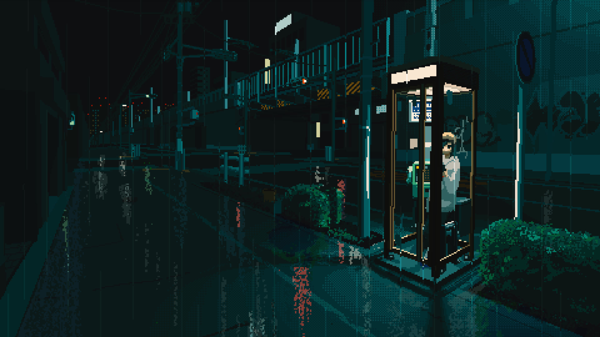<br />
        <sub><b>8bit citylane px</b></sub>
      </a>
    </td>
    <td align="center" width="25%" valign="top">
      <a href="Wallpapers/Aenami_Someday.jpg">
        <br />
        <sub><b>Aenami Someday</b></sub>
      </a>
    </td>
  </tr>
  <tr>
    <td align="center" width="25%" valign="top">
      <a href="Wallpapers/Aenami_Sunset.jpg">
        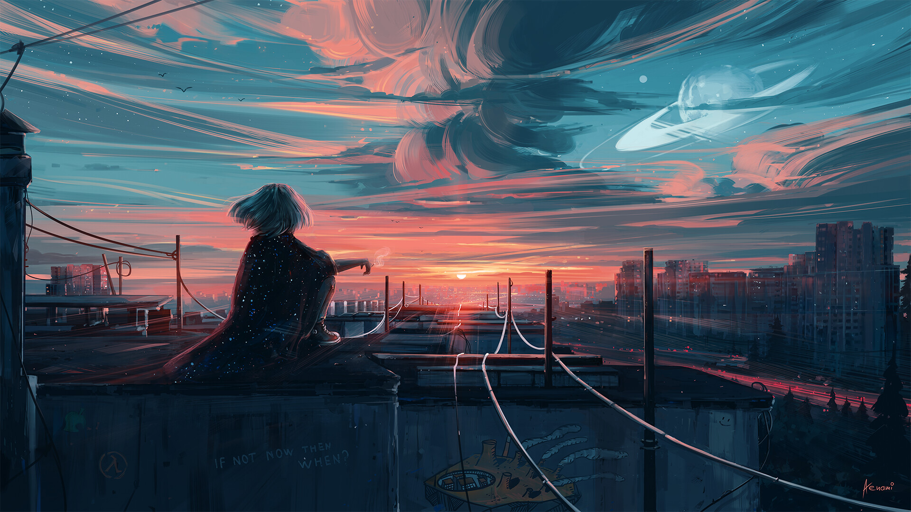<br />
        <sub><b>Aenami Sunset</b></sub>
      </a>
    </td>
    <td align="center" width="25%" valign="top">
      <a href="Wallpapers/Akiakane_Nagori.jpg">
        <br />
        <sub><b>Akiakane Nagori</b></sub>
      </a>
    </td>
    <td align="center" width="25%" valign="top">
      <a href="Wallpapers/Angel%20Warrior.jpg">
        <br />
        <sub><b>Angel Warrior</b></sub>
      </a>
    </td>
    <td align="center" width="25%" valign="top">
      <a href="Wallpapers/Arch_Splatter.jpg">
        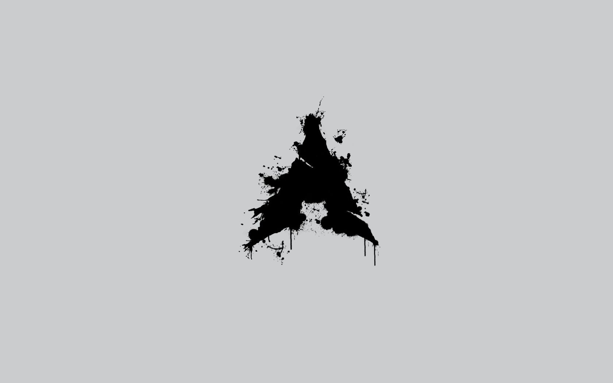<br />
        <sub><b>Arch Splatter</b></sub>
      </a>
    </td>
  </tr>
  <tr>
    <td align="center" width="25%" valign="top">
      <a href="Wallpapers/artist.png">
        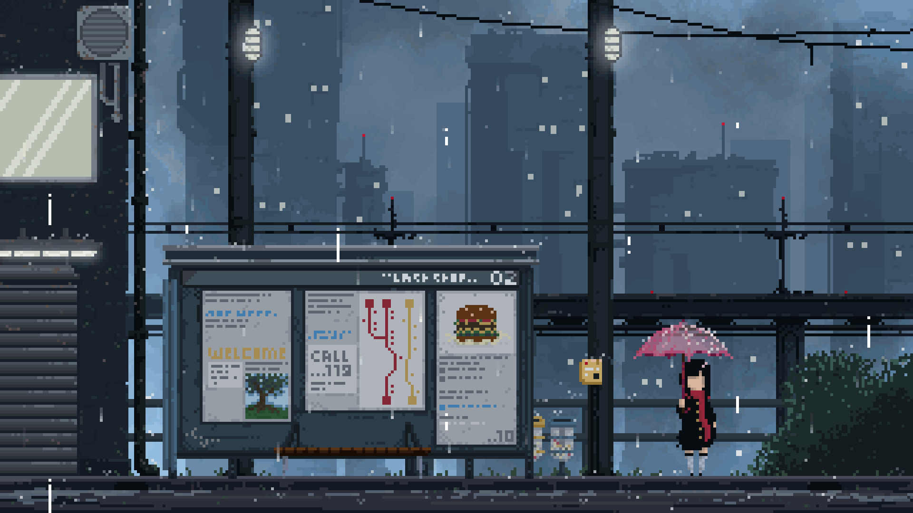<br />
        <sub><b>artist</b></sub>
      </a>
    </td>
    <td align="center" width="25%" valign="top">
      <a href="Wallpapers/Autumn_Avenue.jpg">
        <br />
        <sub><b>Autumn Avenue</b></sub>
      </a>
    </td>
    <td align="center" width="25%" valign="top">
      <a href="Wallpapers/Autumn_Fence.jpg">
        <br />
        <sub><b>Autumn Fence</b></sub>
      </a>
    </td>
    <td align="center" width="25%" valign="top">
      <a href="Wallpapers/Autumn_Road.jpg">
        <br />
        <sub><b>Autumn Road</b></sub>
      </a>
    </td>
  </tr>
  <tr>
    <td align="center" width="25%" valign="top">
      <a href="Wallpapers/Bamboo_Sanctuary.jpg">
        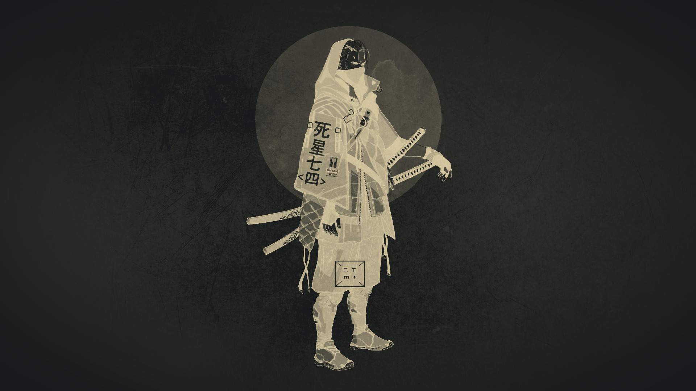<br />
        <sub><b>Bamboo Sanctuary</b></sub>
      </a>
    </td>
    <td align="center" width="25%" valign="top">
      <a href="Wallpapers/Bamboo_Torii.png">
        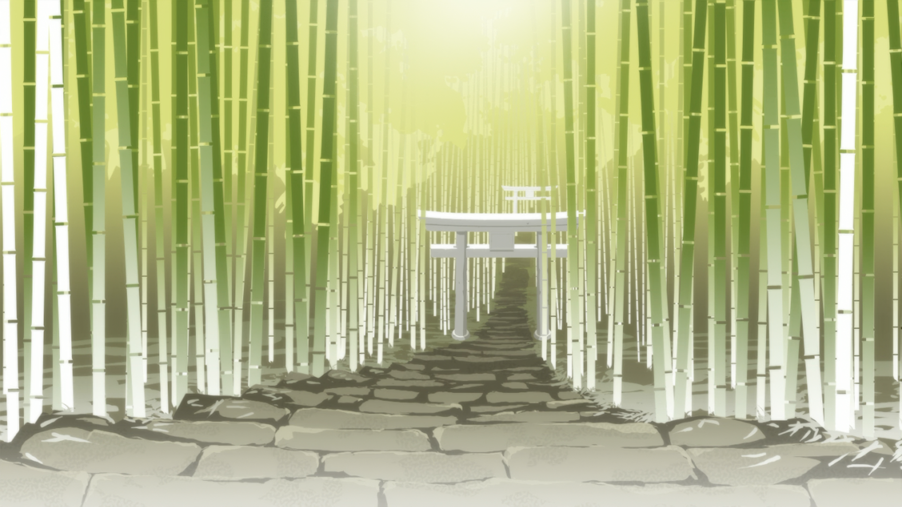<br />
        <sub><b>Bamboo Torii</b></sub>
      </a>
    </td>
    <td align="center" width="25%" valign="top">
      <a href="Wallpapers/Beacon.png">
        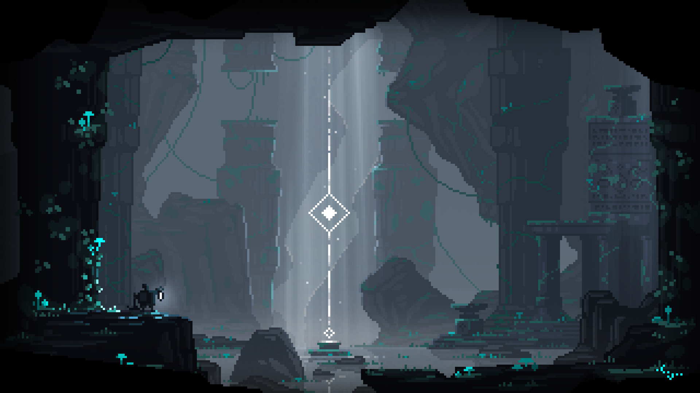<br />
        <sub><b>Beacon</b></sub>
      </a>
    </td>
    <td align="center" width="25%" valign="top">
      <a href="Wallpapers/Blade_Gaze.webp">
        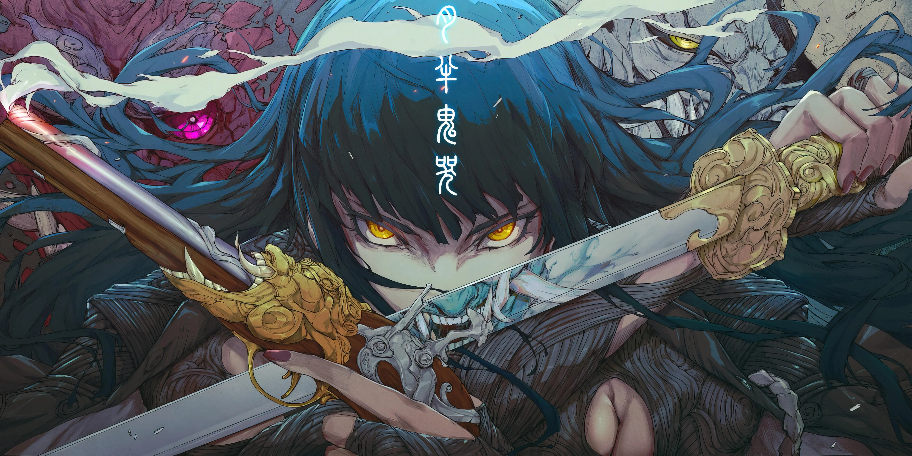<br />
        <sub><b>Blade Gaze</b></sub>
      </a>
    </td>
  </tr>
  <tr>
    <td align="center" width="25%" valign="top">
      <a href="Wallpapers/Blue%20Reverie%20Ado.png">
        <br />
        <sub><b>Blue Reverie Ado</b></sub>
      </a>
    </td>
    <td align="center" width="25%" valign="top">
      <a href="Wallpapers/Blue_Lilies.jpg">
        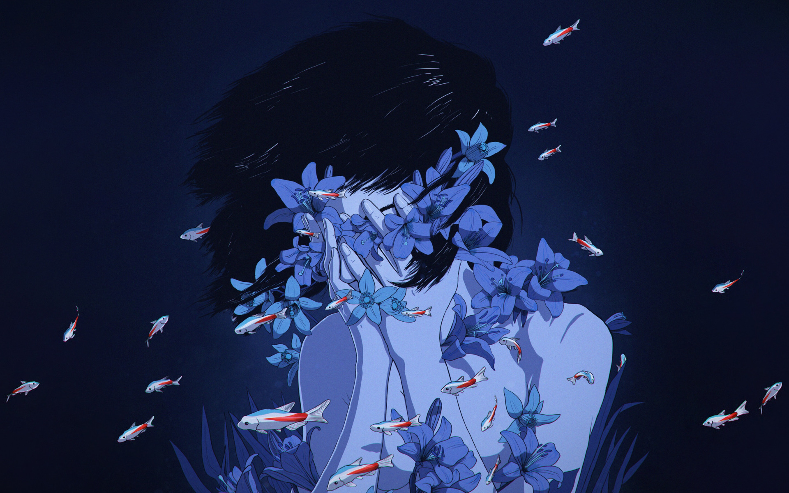<br />
        <sub><b>Blue Lilies</b></sub>
      </a>
    </td>
    <td align="center" width="25%" valign="top">
      <a href="Wallpapers/brain-shell-default-0.png">
        <br />
        <sub><b>brain-shell-default-0</b></sub>
      </a>
    </td>
    <td align="center" width="25%" valign="top">
      <a href="Wallpapers/brain-shell-default-1.png">
        <br />
        <sub><b>brain-shell-default-1</b></sub>
      </a>
    </td>
  </tr>
  <tr>
    <td align="center" width="25%" valign="top">
      <a href="Wallpapers/brain-shell-default-2.jpg">
        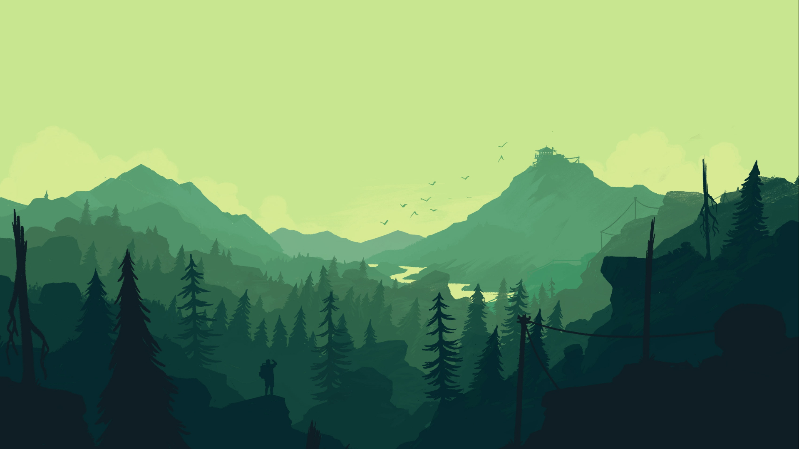<br />
        <sub><b>brain-shell-default-2</b></sub>
      </a>
    </td>
    <td align="center" width="25%" valign="top">
      <a href="Wallpapers/brain-shell-default-3.jpg">
        <br />
        <sub><b>brain-shell-default-3</b></sub>
      </a>
    </td>
    <td align="center" width="25%" valign="top">
      <a href="Wallpapers/brain-shell-default-4.jpg">
        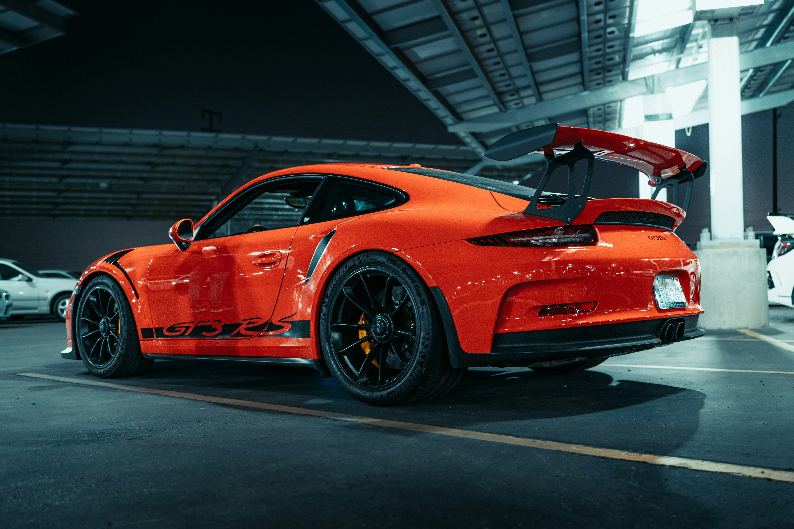<br />
        <sub><b>brain-shell-default-4</b></sub>
      </a>
    </td>
    <td align="center" width="25%" valign="top">
      <a href="Wallpapers/brain-shell-default-5.jpg">
        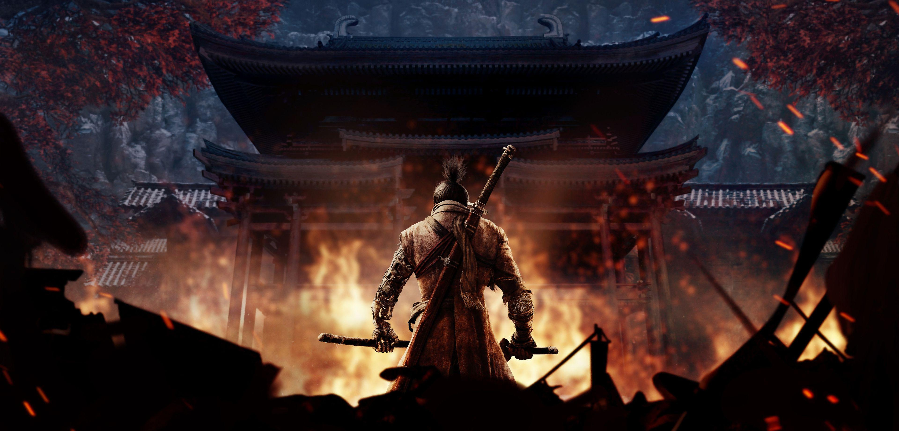<br />
        <sub><b>brain-shell-default-5</b></sub>
      </a>
    </td>
  </tr>
  <tr>
    <td align="center" width="25%" valign="top">
      <a href="Wallpapers/brain-shell-default-6.jpg">
        <br />
        <sub><b>brain-shell-default-6</b></sub>
      </a>
    </td>
    <td align="center" width="25%" valign="top">
      <a href="Wallpapers/Celestial_Storm.jpg">
        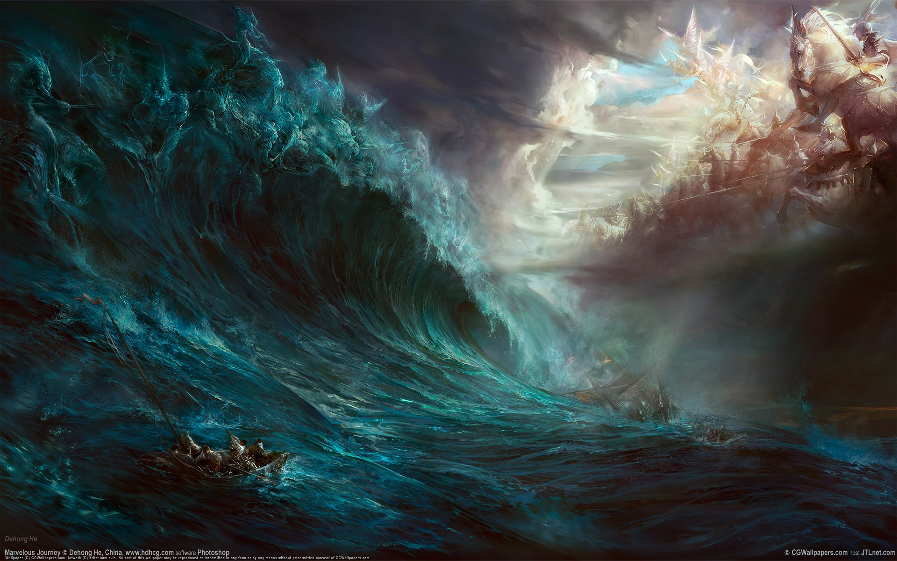<br />
        <sub><b>Celestial Storm</b></sub>
      </a>
    </td>
    <td align="center" width="25%" valign="top">
      <a href="Wallpapers/Chained_Hk_px.png">
        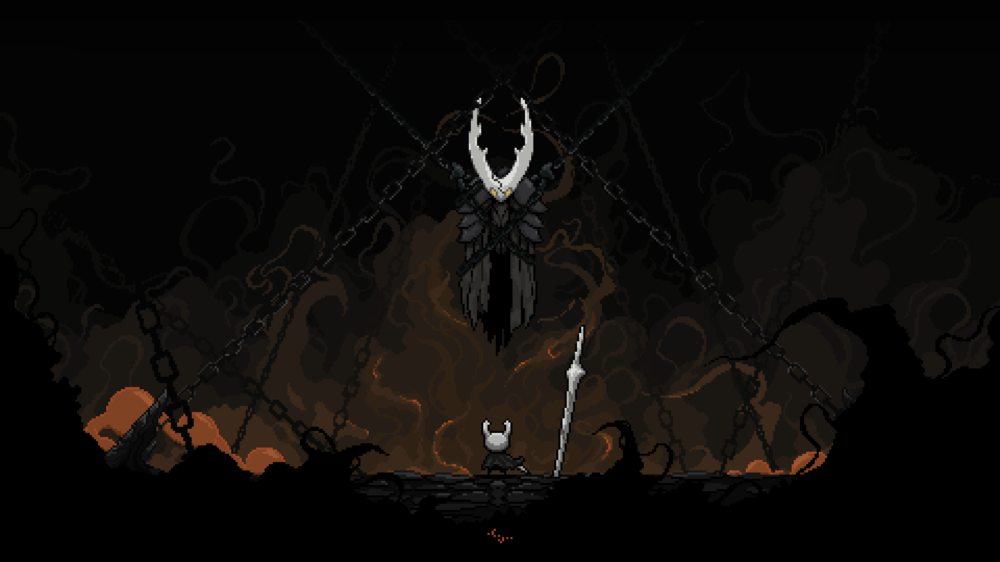<br />
        <sub><b>Chained Hk px</b></sub>
      </a>
    </td>
    <td align="center" width="25%" valign="top">
      <a href="Wallpapers/Chasing_A_Dream.png">
        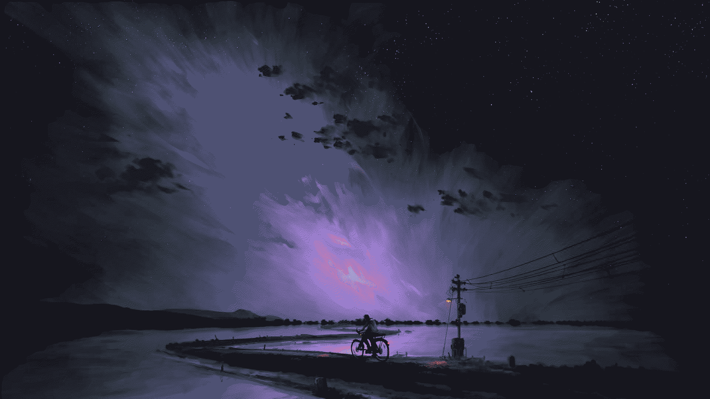<br />
        <sub><b>Chasing A Dream</b></sub>
      </a>
    </td>
  </tr>
  <tr>
    <td align="center" width="25%" valign="top">
      <a href="Wallpapers/City_Overlook.jpg">
        <br />
        <sub><b>City Overlook</b></sub>
      </a>
    </td>
    <td align="center" width="25%" valign="top">
      <a href="Wallpapers/Clair_Obscure.png">
        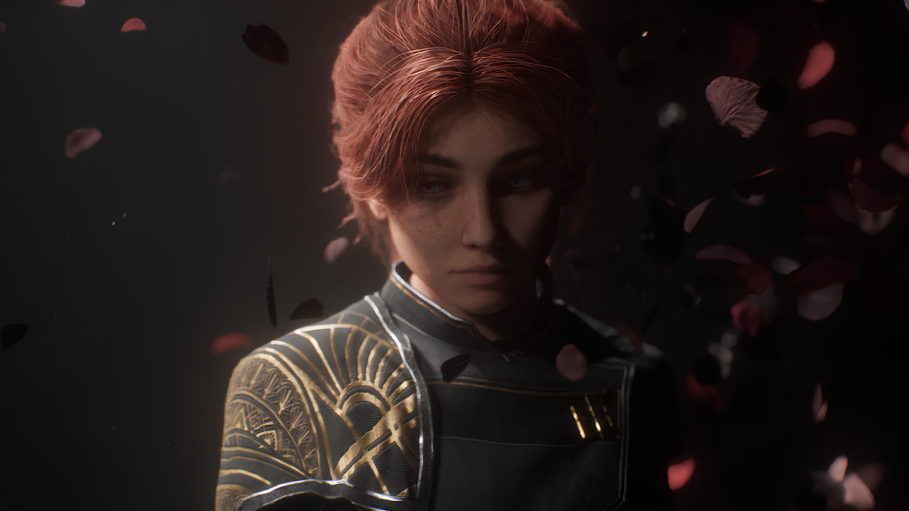<br />
        <sub><b>Clair Obscure</b></sub>
      </a>
    </td>
    <td align="center" width="25%" valign="top">
      <a href="Wallpapers/Cosmic_Girl.png">
        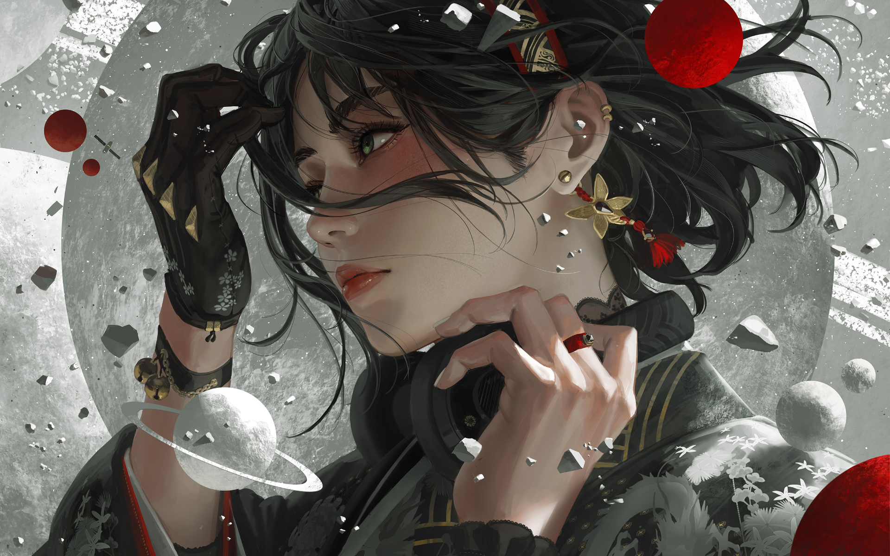<br />
        <sub><b>Cosmic Girl</b></sub>
      </a>
    </td>
    <td align="center" width="25%" valign="top">
      <a href="Wallpapers/Cozy_Fireplace_px.gif">
        <br />
        <sub><b>Cozy Fireplace px</b></sub>
      </a>
    </td>
  </tr>
  <tr>
    <td align="center" width="25%" valign="top">
      <a href="Wallpapers/Cyber_City.png">
        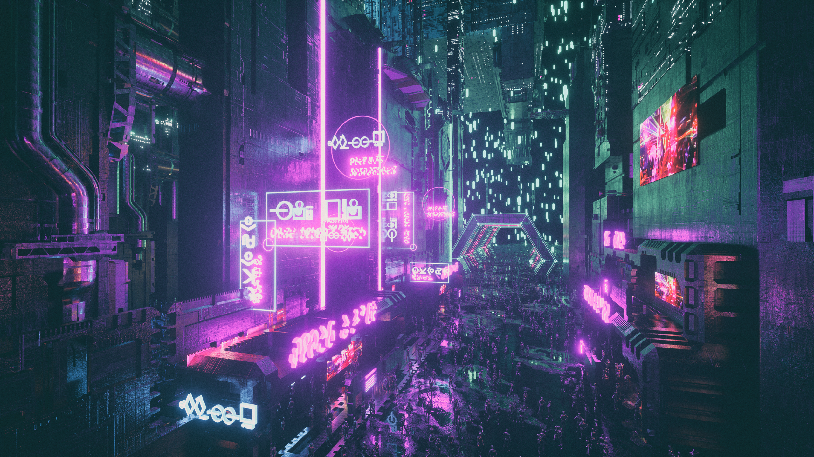<br />
        <sub><b>Cyber City</b></sub>
      </a>
    </td>
    <td align="center" width="25%" valign="top">
      <a href="Wallpapers/Cyber_Oni.jpg">
        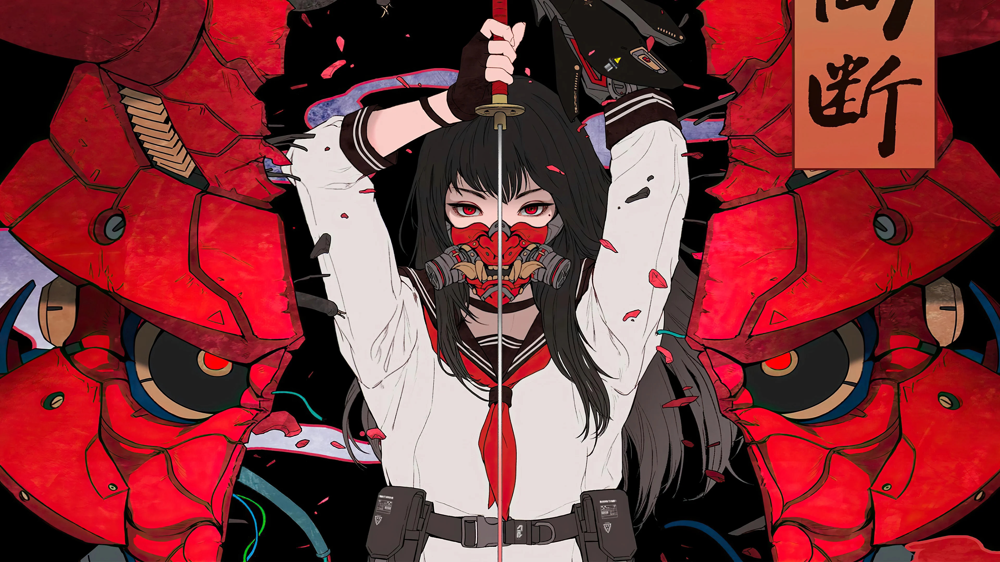<br />
        <sub><b>Cyber Oni</b></sub>
      </a>
    </td>
    <td align="center" width="25%" valign="top">
      <a href="Wallpapers/Cyber_Rain_City_px.gif">
        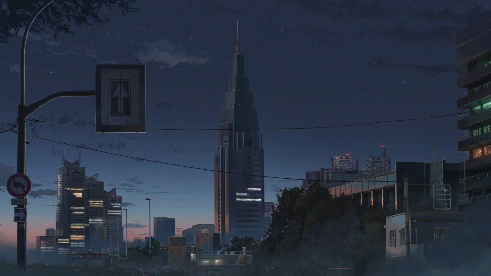<br />
        <sub><b>Cyber Rain City px</b></sub>
      </a>
    </td>
    <td align="center" width="25%" valign="top">
      <a href="Wallpapers/Cyber_Rain_Patrol.jpg">
        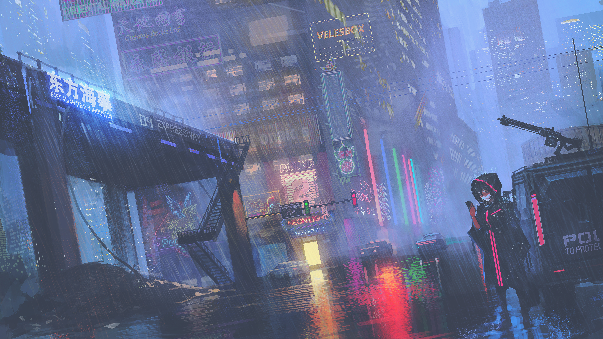<br />
        <sub><b>Cyber Rain Patrol</b></sub>
      </a>
    </td>
  </tr>
  <tr>
    <td align="center" width="25%" valign="top">
      <a href="Wallpapers/Cyber_Sleep.jpg">
        <br />
        <sub><b>Cyber Sleep</b></sub>
      </a>
    </td>
    <td align="center" width="25%" valign="top">
      <a href="Wallpapers/cycle.png">
        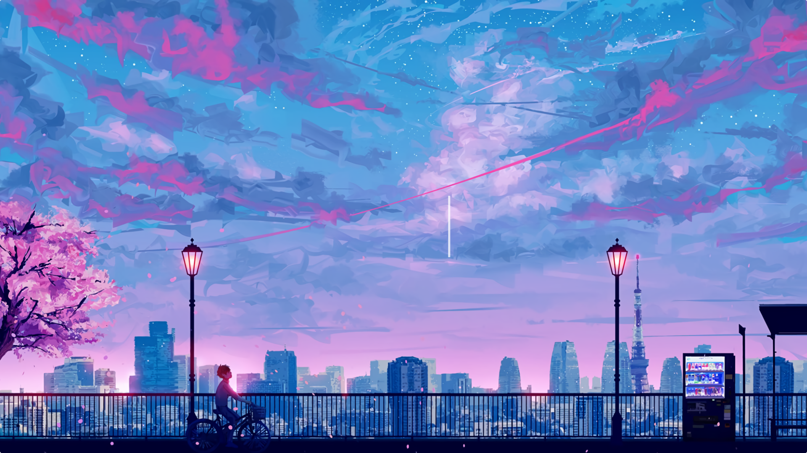<br />
        <sub><b>cycle</b></sub>
      </a>
    </td>
    <td align="center" width="25%" valign="top">
      <a href="Wallpapers/Dark_Angel.png">
        <br />
        <sub><b>Dark Angel</b></sub>
      </a>
    </td>
    <td align="center" width="25%" valign="top">
      <a href="Wallpapers/Dark_Forest.jpg">
        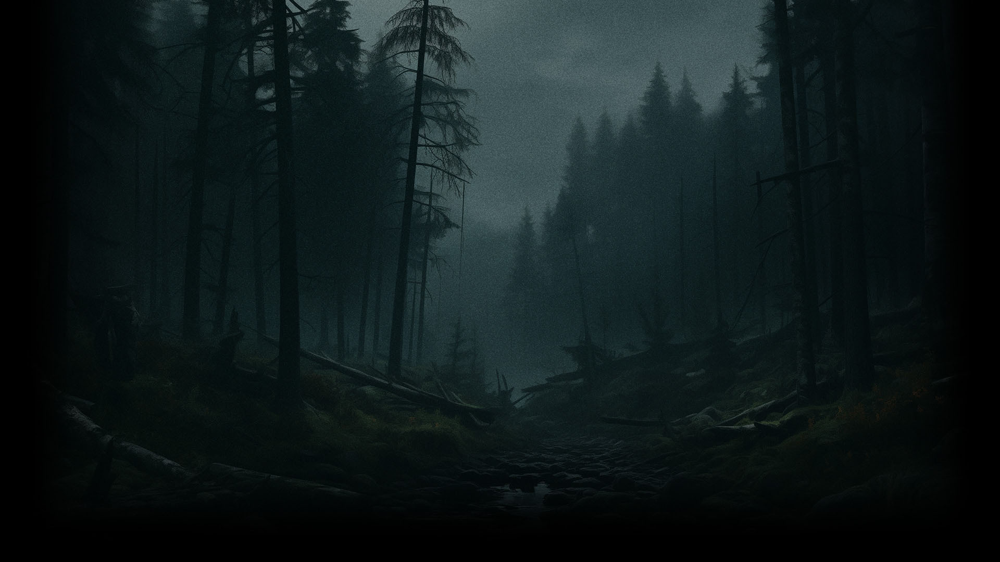<br />
        <sub><b>Dark Forest</b></sub>
      </a>
    </td>
  </tr>
  <tr>
    <td align="center" width="25%" valign="top">
      <a href="Wallpapers/Dark_Goth.jpg">
        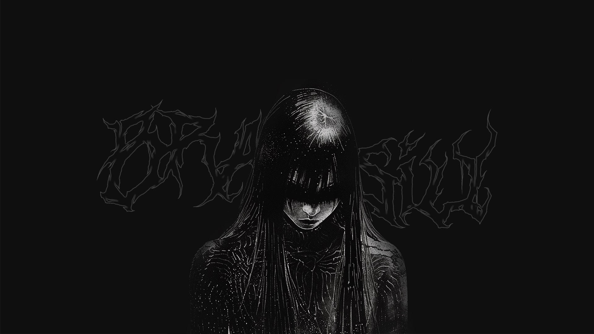<br />
        <sub><b>Dark Goth</b></sub>
      </a>
    </td>
    <td align="center" width="25%" valign="top">
      <a href="Wallpapers/Dark_Nature_Vector.png">
        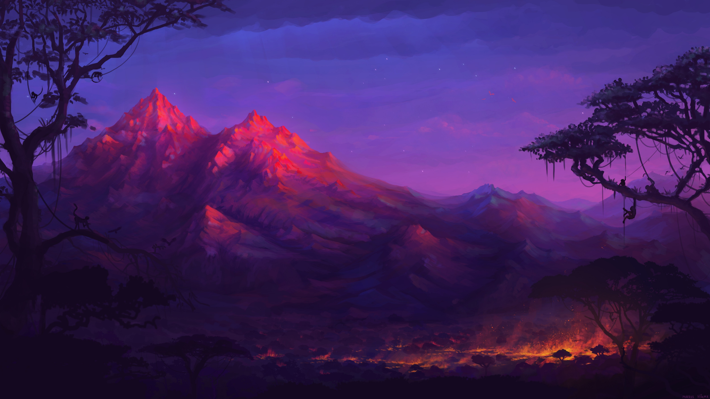<br />
        <sub><b>Dark Nature Vector</b></sub>
      </a>
    </td>
    <td align="center" width="25%" valign="top">
      <a href="Wallpapers/Dark_Reflection.jpg">
        <br />
        <sub><b>Dark Reflection</b></sub>
      </a>
    </td>
    <td align="center" width="25%" valign="top">
      <a href="Wallpapers/Desert_Stargate.jpg">
        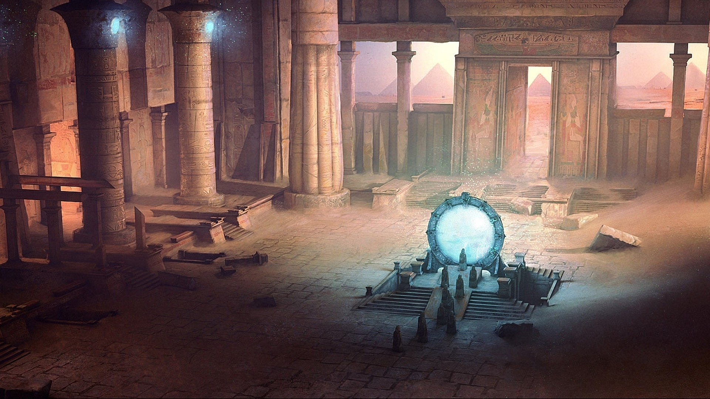<br />
        <sub><b>Desert Stargate</b></sub>
      </a>
    </td>
  </tr>
  <tr>
    <td align="center" width="25%" valign="top">
      <a href="Wallpapers/digital_gojo.png">
        <br />
        <sub><b>digital gojo</b></sub>
      </a>
    </td>
    <td align="center" width="25%" valign="top">
      <a href="Wallpapers/Dragon_Flight.jpg">
        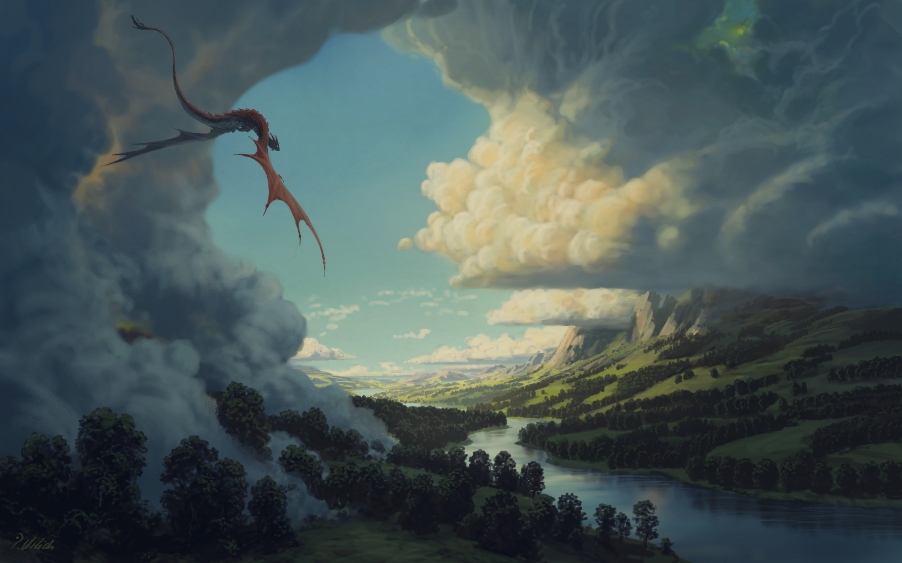<br />
        <sub><b>Dragon Flight</b></sub>
      </a>
    </td>
    <td align="center" width="25%" valign="top">
      <a href="Wallpapers/dragon_katana.jpg">
        <br />
        <sub><b>dragon katana</b></sub>
      </a>
    </td>
    <td align="center" width="25%" valign="top">
      <a href="Wallpapers/Dragon_Rider.jpg">
        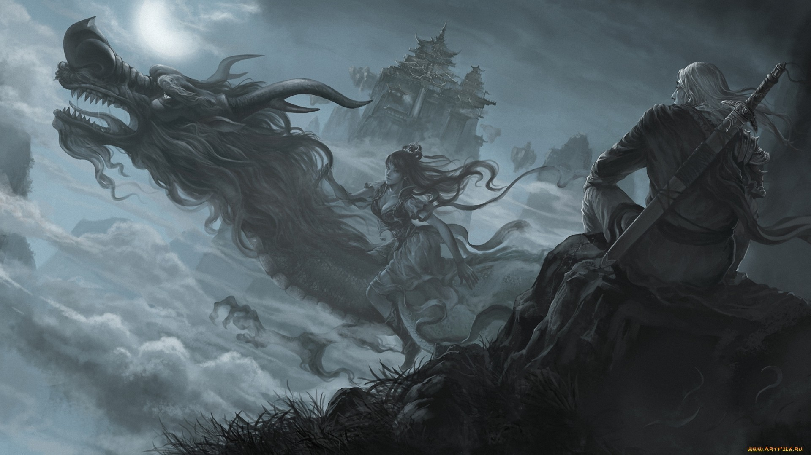<br />
        <sub><b>Dragon Rider</b></sub>
      </a>
    </td>
  </tr>
  <tr>
    <td align="center" width="25%" valign="top">
      <a href="Wallpapers/Dragon_Temple.jpg">
        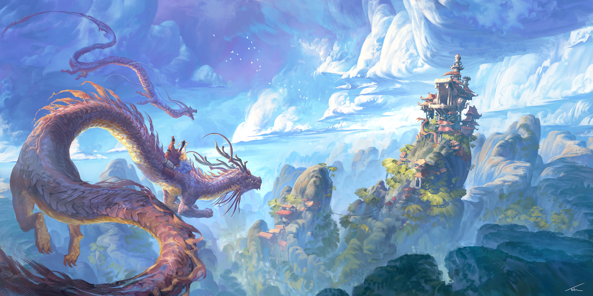<br />
        <sub><b>Dragon Temple</b></sub>
      </a>
    </td>
    <td align="center" width="25%" valign="top">
      <a href="Wallpapers/Elden_balcony.png">
        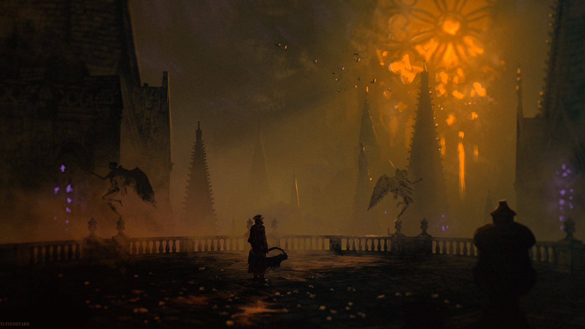<br />
        <sub><b>Elden balcony</b></sub>
      </a>
    </td>
    <td align="center" width="25%" valign="top">
      <a href="Wallpapers/Elden_Recluse.jpg">
        <br />
        <sub><b>Elden Recluse</b></sub>
      </a>
    </td>
    <td align="center" width="25%" valign="top">
      <a href="Wallpapers/Empty_Thinker.jpg">
        <br />
        <sub><b>Empty Thinker</b></sub>
      </a>
    </td>
  </tr>
  <tr>
    <td align="center" width="25%" valign="top">
      <a href="Wallpapers/Expedition_Moon.jpg">
        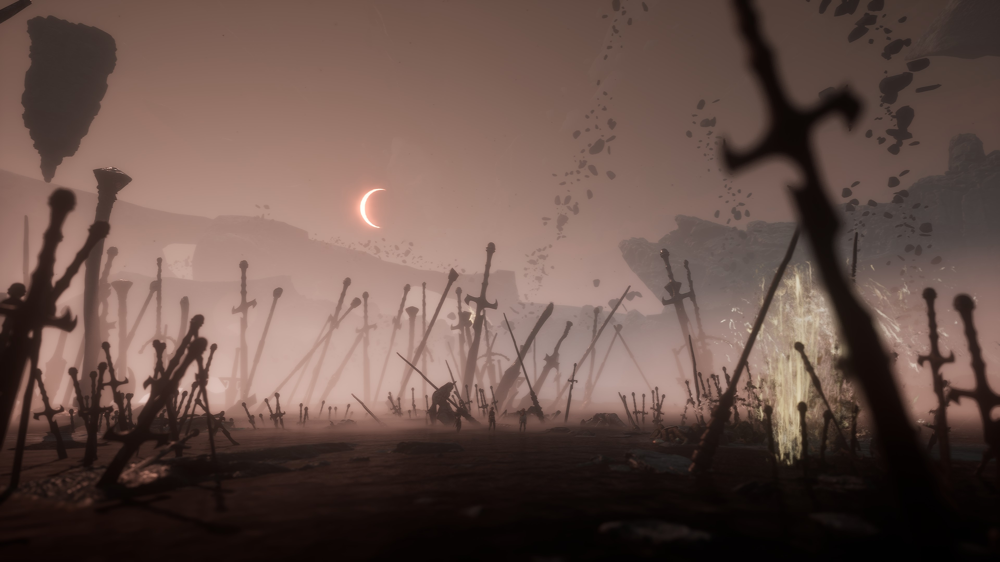<br />
        <sub><b>Expedition Moon</b></sub>
      </a>
    </td>
    <td align="center" width="25%" valign="top">
      <a href="Wallpapers/Fang_Yuan.jpg">
        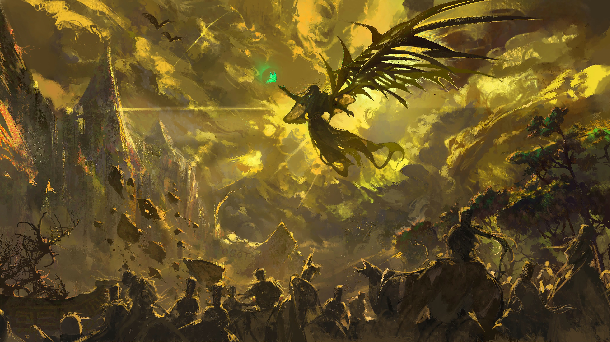<br />
        <sub><b>Fang Yuan</b></sub>
      </a>
    </td>
    <td align="center" width="25%" valign="top">
      <a href="Wallpapers/Fog_Bridge.jpg">
        <br />
        <sub><b>Fog Bridge</b></sub>
      </a>
    </td>
    <td align="center" width="25%" valign="top">
      <a href="Wallpapers/Fog_Hut_Tori.jpeg">
        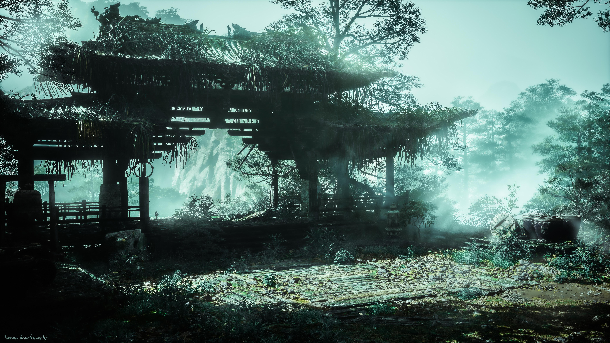<br />
        <sub><b>Fog Hut Tori</b></sub>
      </a>
    </td>
  </tr>
  <tr>
    <td align="center" width="25%" valign="top">
      <a href="Wallpapers/Forbidden_West.png">
        <br />
        <sub><b>Forbidden West</b></sub>
      </a>
    </td>
    <td align="center" width="25%" valign="top">
      <a href="Wallpapers/Forest_Tori.jpg">
        <br />
        <sub><b>Forest Tori</b></sub>
      </a>
    </td>
    <td align="center" width="25%" valign="top">
      <a href="Wallpapers/frieren.png">
        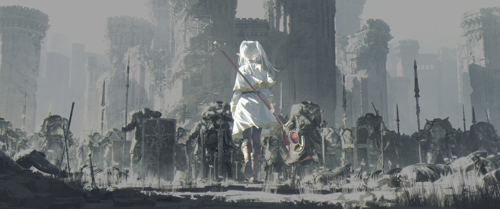<br />
        <sub><b>frieren</b></sub>
      </a>
    </td>
    <td align="center" width="25%" valign="top">
      <a href="Wallpapers/fronin.jpg">
        <br />
        <sub><b>fronin</b></sub>
      </a>
    </td>
  </tr>
  <tr>
    <td align="center" width="25%" valign="top">
      <a href="Wallpapers/fsamurai.png">
        <br />
        <sub><b>fsamurai</b></sub>
      </a>
    </td>
    <td align="center" width="25%" valign="top">
      <a href="Wallpapers/Fuji_Pagoda.jpg">
        <br />
        <sub><b>Fuji Pagoda</b></sub>
      </a>
    </td>
    <td align="center" width="25%" valign="top">
      <a href="Wallpapers/Fuji_Tori.jpg">
        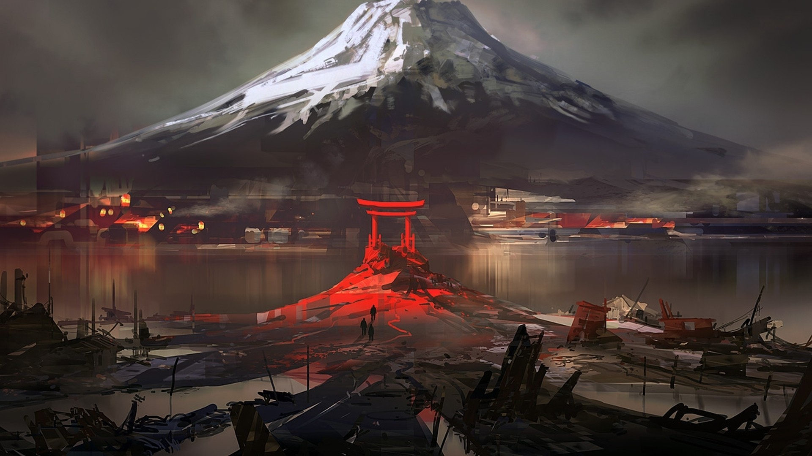<br />
        <sub><b>Fuji Tori</b></sub>
      </a>
    </td>
    <td align="center" width="25%" valign="top">
      <a href="Wallpapers/Futemnet.png">
        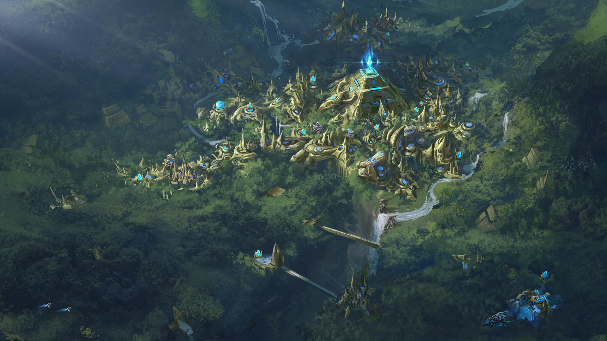<br />
        <sub><b>Futemnet</b></sub>
      </a>
    </td>
  </tr>
  <tr>
    <td align="center" width="25%" valign="top">
      <a href="Wallpapers/futeristic_city.jpg">
        <br />
        <sub><b>futeristic city</b></sub>
      </a>
    </td>
    <td align="center" width="25%" valign="top">
      <a href="Wallpapers/Gaurd_view.png">
        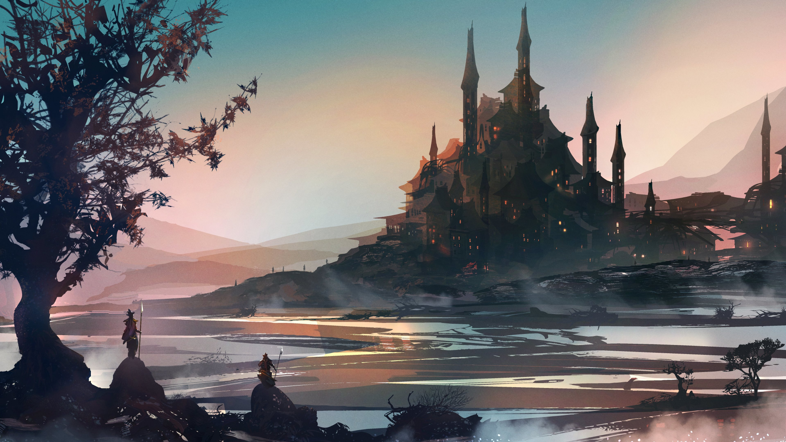<br />
        <sub><b>Gaurd view</b></sub>
      </a>
    </td>
    <td align="center" width="25%" valign="top">
      <a href="Wallpapers/ghostly-gate.jpg">
        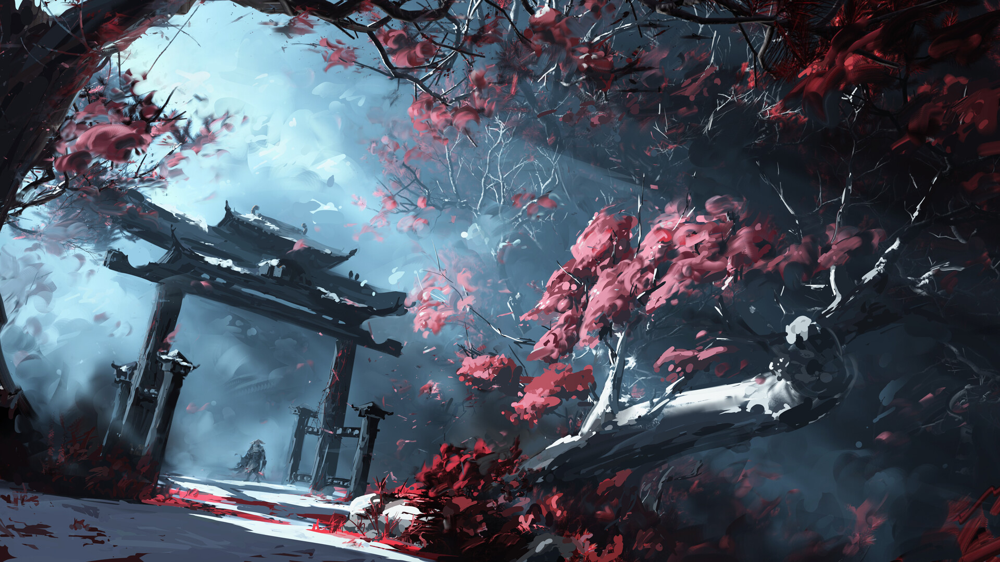<br />
        <sub><b>ghostly-gate</b></sub>
      </a>
    </td>
    <td align="center" width="25%" valign="top">
      <a href="Wallpapers/Glitch_Girl.gif">
        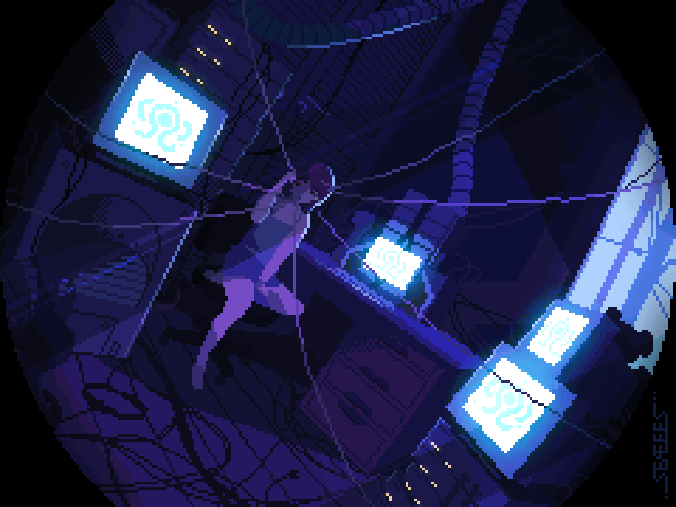<br />
        <sub><b>Glitch Girl</b></sub>
      </a>
    </td>
  </tr>
  <tr>
    <td align="center" width="25%" valign="top">
      <a href="Wallpapers/Guts.png">
        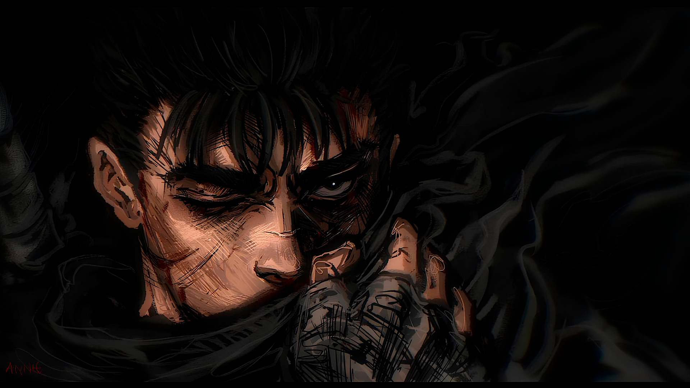<br />
        <sub><b>Guts</b></sub>
      </a>
    </td>
    <td align="center" width="25%" valign="top">
      <a href="Wallpapers/Harbor_Post_px.jpg">
        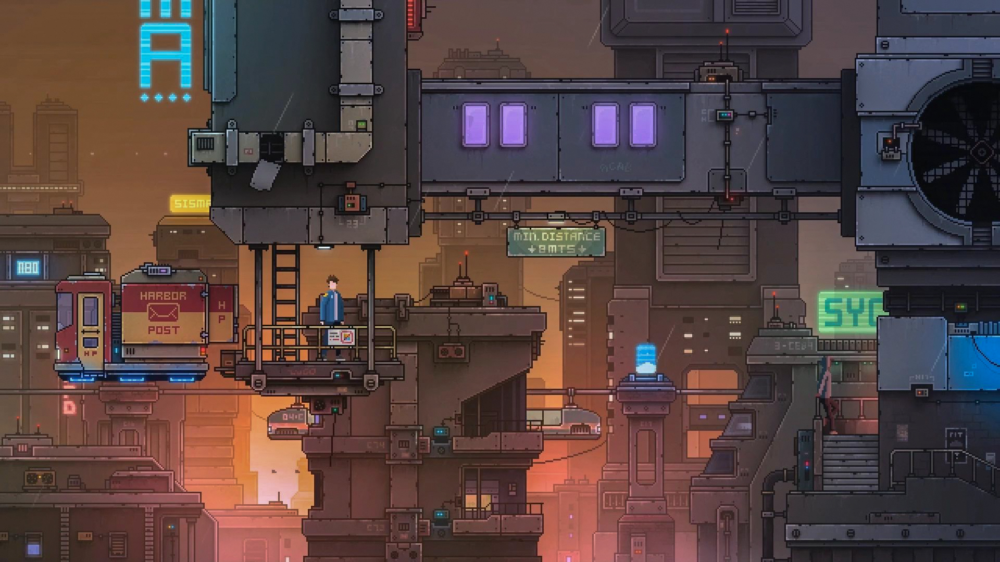<br />
        <sub><b>Harbor Post px</b></sub>
      </a>
    </td>
    <td align="center" width="25%" valign="top">
      <a href="Wallpapers/Heavy%20Elevator.jpg">
        <br />
        <sub><b>Heavy Elevator</b></sub>
      </a>
    </td>
    <td align="center" width="25%" valign="top">
      <a href="Wallpapers/Hero_sword_px.jpg">
        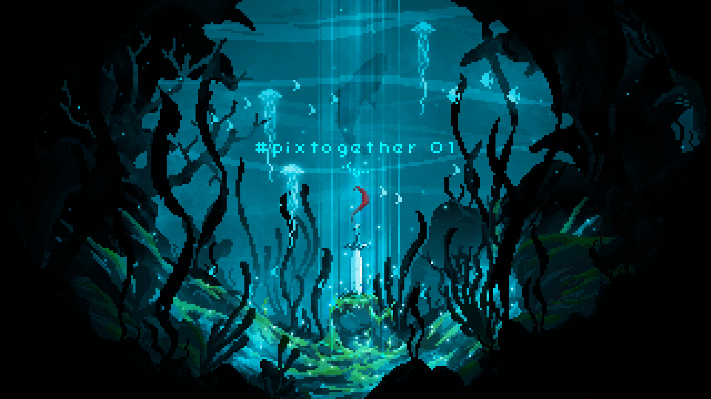<br />
        <sub><b>Hero sword px</b></sub>
      </a>
    </td>
  </tr>
  <tr>
    <td align="center" width="25%" valign="top">
      <a href="Wallpapers/High_Priest_px.gif">
        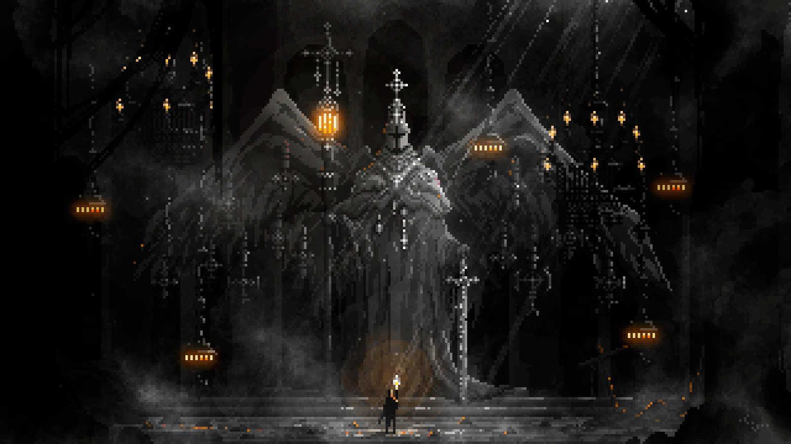<br />
        <sub><b>High Priest px</b></sub>
      </a>
    </td>
    <td align="center" width="25%" valign="top">
      <a href="Wallpapers/hk.jpg">
        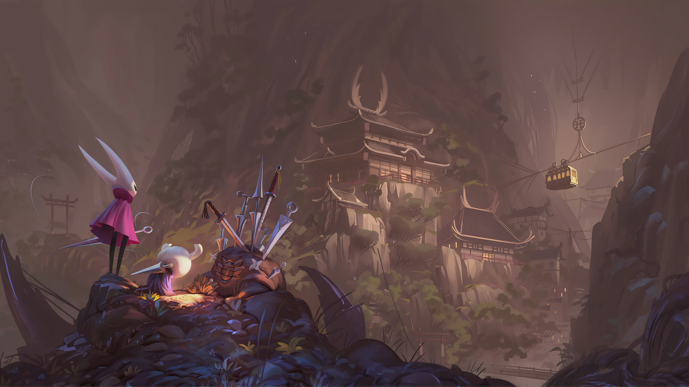<br />
        <sub><b>hk</b></sub>
      </a>
    </td>
    <td align="center" width="25%" valign="top">
      <a href="Wallpapers/hornet_px.gif">
        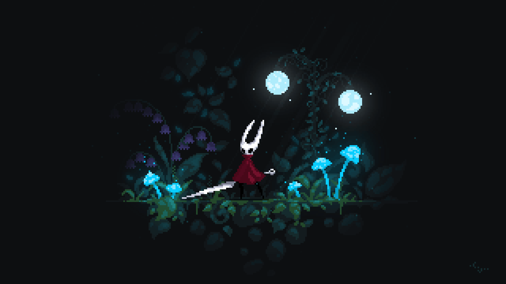<br />
        <sub><b>hornet px</b></sub>
      </a>
    </td>
    <td align="center" width="25%" valign="top">
      <a href="Wallpapers/hunt_showdown.jpg">
        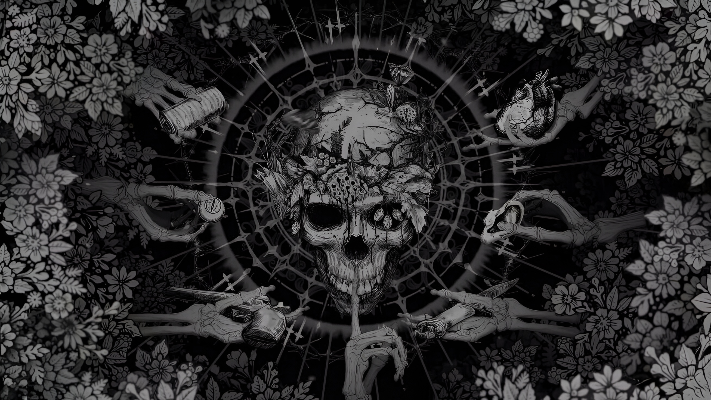<br />
        <sub><b>hunt showdown</b></sub>
      </a>
    </td>
  </tr>
  <tr>
    <td align="center" width="25%" valign="top">
      <a href="Wallpapers/ice_drag.png">
        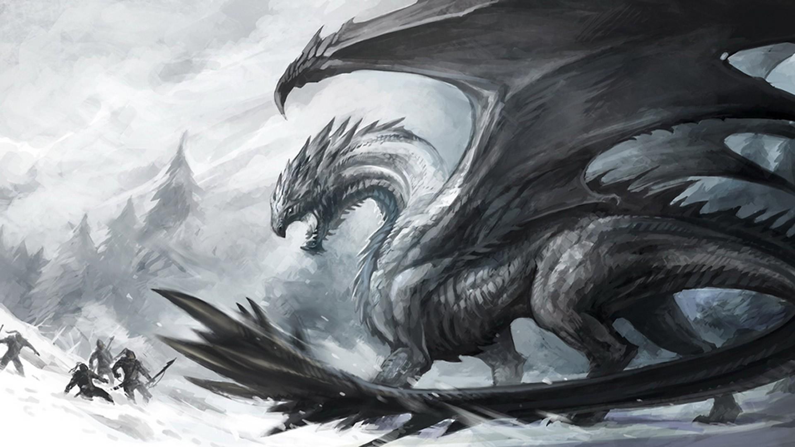<br />
        <sub><b>ice drag</b></sub>
      </a>
    </td>
    <td align="center" width="25%" valign="top">
      <a href="Wallpapers/jp_rain_px.gif">
        <br />
        <sub><b>jp rain px</b></sub>
      </a>
    </td>
    <td align="center" width="25%" valign="top">
      <a href="Wallpapers/katana_girl.jpg">
        <br />
        <sub><b>katana girl</b></sub>
      </a>
    </td>
    <td align="center" width="25%" valign="top">
      <a href="Wallpapers/katana_girl_red.jpg">
        <br />
        <sub><b>katana girl red</b></sub>
      </a>
    </td>
  </tr>
  <tr>
    <td align="center" width="25%" valign="top">
      <a href="Wallpapers/Kitsune_Outline.png">
        <br />
        <sub><b>Kitsune Outline</b></sub>
      </a>
    </td>
    <td align="center" width="25%" valign="top">
      <a href="Wallpapers/knight_px.gif">
        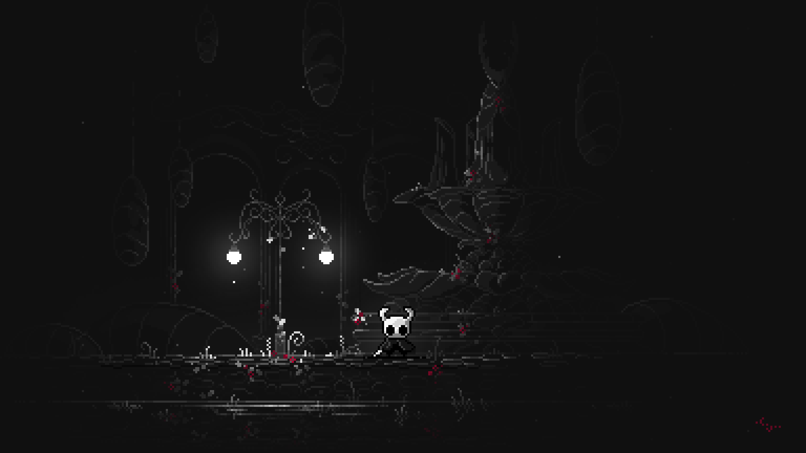<br />
        <sub><b>knight px</b></sub>
      </a>
    </td>
    <td align="center" width="25%" valign="top">
      <a href="Wallpapers/Lantern_City.png">
        <br />
        <sub><b>Lantern City</b></sub>
      </a>
    </td>
    <td align="center" width="25%" valign="top">
      <a href="Wallpapers/lava_sakura.jpg">
        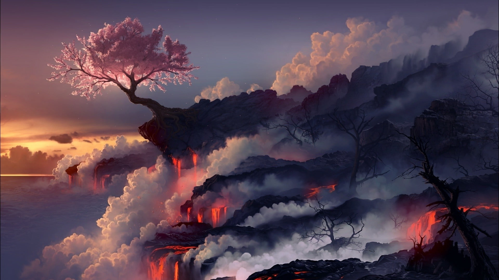<br />
        <sub><b>lava sakura</b></sub>
      </a>
    </td>
  </tr>
  <tr>
    <td align="center" width="25%" valign="top">
      <a href="Wallpapers/Leon_RPD.png">
        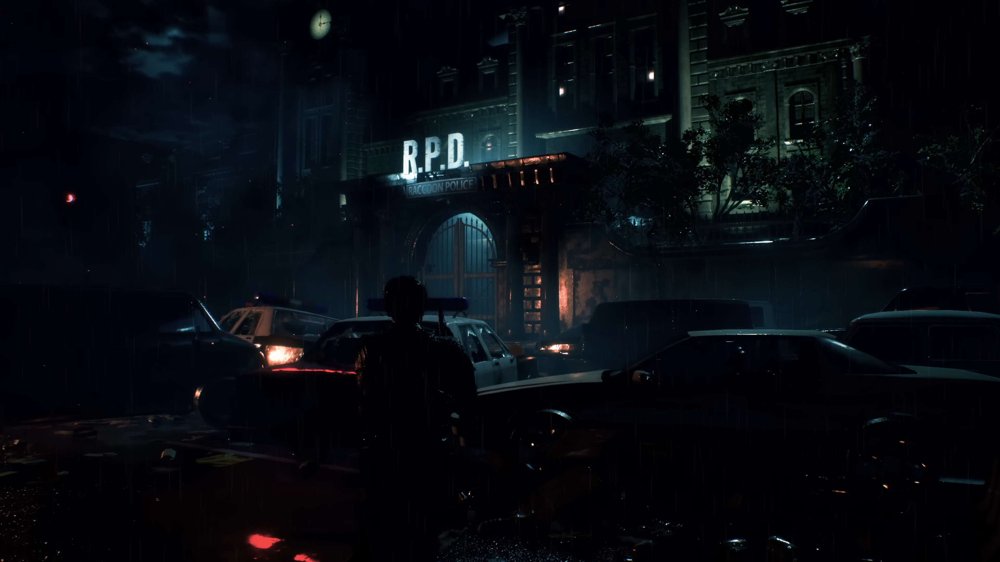<br />
        <sub><b>Leon RPD</b></sub>
      </a>
    </td>
    <td align="center" width="25%" valign="top">
      <a href="Wallpapers/Lucy.png">
        <br />
        <sub><b>Lucy</b></sub>
      </a>
    </td>
    <td align="center" width="25%" valign="top">
      <a href="Wallpapers/Luffy.jpg">
        <br />
        <sub><b>Luffy</b></sub>
      </a>
    </td>
    <td align="center" width="25%" valign="top">
      <a href="Wallpapers/Luo_Tianyi.jpg">
        <br />
        <sub><b>Luo Tianyi</b></sub>
      </a>
    </td>
  </tr>
  <tr>
    <td align="center" width="25%" valign="top">
      <a href="Wallpapers/May_Waterfall_px.png">
        <br />
        <sub><b>May Waterfall px</b></sub>
      </a>
    </td>
    <td align="center" width="25%" valign="top">
      <a href="Wallpapers/megumi.png">
        <br />
        <sub><b>megumi</b></sub>
      </a>
    </td>
    <td align="center" width="25%" valign="top">
      <a href="Wallpapers/Memories%20of%20that%20Summer%20Mocha.jpg">
        <br />
        <sub><b>Memories of that Summer Mocha</b></sub>
      </a>
    </td>
    <td align="center" width="25%" valign="top">
      <a href="Wallpapers/miku.png">
        <br />
        <sub><b>miku</b></sub>
      </a>
    </td>
  </tr>
  <tr>
    <td align="center" width="25%" valign="top">
      <a href="Wallpapers/monstarui.jpg">
        <br />
        <sub><b>monstarui</b></sub>
      </a>
    </td>
    <td align="center" width="25%" valign="top">
      <a href="Wallpapers/Mountain_Valley.jpg">
        <br />
        <sub><b>Mountain Valley</b></sub>
      </a>
    </td>
    <td align="center" width="25%" valign="top">
      <a href="Wallpapers/mushroom_village.png">
        <br />
        <sub><b>mushroom village</b></sub>
      </a>
    </td>
    <td align="center" width="25%" valign="top">
      <a href="Wallpapers/Nier.jpg">
        <br />
        <sub><b>Nier</b></sub>
      </a>
    </td>
  </tr>
  <tr>
    <td align="center" width="25%" valign="top">
      <a href="Wallpapers/nier_automata.png">
        <br />
        <sub><b>nier automata</b></sub>
      </a>
    </td>
    <td align="center" width="25%" valign="top">
      <a href="Wallpapers/Nier_Automata.png">
        <br />
        <sub><b>Nier Automata</b></sub>
      </a>
    </td>
    <td align="center" width="25%" valign="top">
      <a href="Wallpapers/OBIWWAH.png">
        <br />
        <sub><b>OBIWWAH</b></sub>
      </a>
    </td>
    <td align="center" width="25%" valign="top">
      <a href="Wallpapers/Old_Observatory.jpg">
        <br />
        <sub><b>Old Observatory</b></sub>
      </a>
    </td>
  </tr>
  <tr>
    <td align="center" width="25%" valign="top">
      <a href="Wallpapers/Pagoda_City.jpg">
        <br />
        <sub><b>Pagoda City</b></sub>
      </a>
    </td>
    <td align="center" width="25%" valign="top">
      <a href="Wallpapers/Phrolova_Gaze.jpg">
        <br />
        <sub><b>Phrolova Gaze</b></sub>
      </a>
    </td>
    <td align="center" width="25%" valign="top">
      <a href="Wallpapers/Pink_Canopy.jpg">
        <br />
        <sub><b>Pink Canopy</b></sub>
      </a>
    </td>
    <td align="center" width="25%" valign="top">
      <a href="Wallpapers/Pink_Tangle.jpg">
        <br />
        <sub><b>Pink Tangle</b></sub>
      </a>
    </td>
  </tr>
  <tr>
    <td align="center" width="25%" valign="top">
      <a href="Wallpapers/plauge_shrine_px.gif">
        <br />
        <sub><b>plauge shrine px</b></sub>
      </a>
    </td>
    <td align="center" width="25%" valign="top">
      <a href="Wallpapers/Power%20Station.jpg">
        <br />
        <sub><b>Power Station</b></sub>
      </a>
    </td>
    <td align="center" width="25%" valign="top">
      <a href="Wallpapers/Purple_Night.png">
        <br />
        <sub><b>Purple Night</b></sub>
      </a>
    </td>
    <td align="center" width="25%" valign="top">
      <a href="Wallpapers/Rainy_Street.png">
        <br />
        <sub><b>Rainy Street</b></sub>
      </a>
    </td>
  </tr>
  <tr>
    <td align="center" width="25%" valign="top">
      <a href="Wallpapers/Rainy_Windshield.jpg">
        <br />
        <sub><b>Rainy Windshield</b></sub>
      </a>
    </td>
    <td align="center" width="25%" valign="top">
      <a href="Wallpapers/Red_Balloons.jpeg">
        <br />
        <sub><b>Red Balloons</b></sub>
      </a>
    </td>
    <td align="center" width="25%" valign="top">
      <a href="Wallpapers/Red_Eclipse.jpg">
        <br />
        <sub><b>Red Eclipse</b></sub>
      </a>
    </td>
    <td align="center" width="25%" valign="top">
      <a href="Wallpapers/Red_Forest.jpg">
        <br />
        <sub><b>Red Forest</b></sub>
      </a>
    </td>
  </tr>
  <tr>
    <td align="center" width="25%" valign="top">
      <a href="Wallpapers/Red_Goth.jpg">
        <br />
        <sub><b>Red Goth</b></sub>
      </a>
    </td>
    <td align="center" width="25%" valign="top">
      <a href="Wallpapers/Red_Nebula.jpg">
        <br />
        <sub><b>Red Nebula</b></sub>
      </a>
    </td>
    <td align="center" width="25%" valign="top">
      <a href="Wallpapers/Red_Shadow.jpg">
        <br />
        <sub><b>Red Shadow</b></sub>
      </a>
    </td>
    <td align="center" width="25%" valign="top">
      <a href="Wallpapers/Red_Umbrella.png">
        <br />
        <sub><b>Red Umbrella</b></sub>
      </a>
    </td>
  </tr>
  <tr>
    <td align="center" width="25%" valign="top">
      <a href="Wallpapers/Retro_Metropolis.jpg">
        <br />
        <sub><b>Retro Metropolis</b></sub>
      </a>
    </td>
    <td align="center" width="25%" valign="top">
      <a href="Wallpapers/reze-blue-butterfly.png">
        <br />
        <sub><b>reze-blue-butterfly</b></sub>
      </a>
    </td>
    <td align="center" width="25%" valign="top">
      <a href="Wallpapers/Roadside_Dawn.jpg">
        <br />
        <sub><b>Roadside Dawn</b></sub>
      </a>
    </td>
    <td align="center" width="25%" valign="top">
      <a href="Wallpapers/Sakura_Katana.jpg">
        <br />
        <sub><b>Sakura Katana</b></sub>
      </a>
    </td>
  </tr>
  <tr>
    <td align="center" width="25%" valign="top">
      <a href="Wallpapers/Sekiro%20vs%20Owl.jpg">
        <br />
        <sub><b>Sekiro vs Owl</b></sub>
      </a>
    </td>
    <td align="center" width="25%" valign="top">
      <a href="Wallpapers/Sekiro_Moon.jpg">
        <br />
        <sub><b>Sekiro Moon</b></sub>
      </a>
    </td>
    <td align="center" width="25%" valign="top">
      <a href="Wallpapers/Seraph_Encounter.png">
        <br />
        <sub><b>Seraph Encounter</b></sub>
      </a>
    </td>
    <td align="center" width="25%" valign="top">
      <a href="Wallpapers/Serpent_px.gif">
        <br />
        <sub><b>Serpent px</b></sub>
      </a>
    </td>
  </tr>
  <tr>
    <td align="center" width="25%" valign="top">
      <a href="Wallpapers/Shadows%20Die%20Twice.jpg">
        <br />
        <sub><b>Shadows Die Twice</b></sub>
      </a>
    </td>
    <td align="center" width="25%" valign="top">
      <a href="Wallpapers/Shinkai_Station.png">
        <br />
        <sub><b>Shinkai Station</b></sub>
      </a>
    </td>
    <td align="center" width="25%" valign="top">
      <a href="Wallpapers/Snow_Ronin.jpg">
        <br />
        <sub><b>Snow Ronin</b></sub>
      </a>
    </td>
    <td align="center" width="25%" valign="top">
      <a href="Wallpapers/Space_Angel.png">
        <br />
        <sub><b>Space Angel</b></sub>
      </a>
    </td>
  </tr>
  <tr>
    <td align="center" width="25%" valign="top">
      <a href="Wallpapers/Space_Fleet.jpg">
        <br />
        <sub><b>Space Fleet</b></sub>
      </a>
    </td>
    <td align="center" width="25%" valign="top">
      <a href="Wallpapers/Space_Station.jpg">
        <br />
        <sub><b>Space Station</b></sub>
      </a>
    </td>
    <td align="center" width="25%" valign="top">
      <a href="Wallpapers/Space_Window.jpg">
        <br />
        <sub><b>Space Window</b></sub>
      </a>
    </td>
    <td align="center" width="25%" valign="top">
      <a href="Wallpapers/Spirit%20Flute.jpg">
        <br />
        <sub><b>Spirit Flute</b></sub>
      </a>
    </td>
  </tr>
  <tr>
    <td align="center" width="25%" valign="top">
      <a href="Wallpapers/Stairs_car.gif">
        <br />
        <sub><b>Stairs car</b></sub>
      </a>
    </td>
    <td align="center" width="25%" valign="top">
      <a href="Wallpapers/Sunset_Eye.png">
        <br />
        <sub><b>Sunset Eye</b></sub>
      </a>
    </td>
    <td align="center" width="25%" valign="top">
      <a href="Wallpapers/Sunset_Rooftop.jpg">
        <br />
        <sub><b>Sunset Rooftop</b></sub>
      </a>
    </td>
    <td align="center" width="25%" valign="top">
      <a href="Wallpapers/Synthwave_Bridge.jpg">
        <br />
        <sub><b>Synthwave Bridge</b></sub>
      </a>
    </td>
  </tr>
  <tr>
    <td align="center" width="25%" valign="top">
      <a href="Wallpapers/Thousand%20Sunny.jpg">
        <br />
        <sub><b>Thousand Sunny</b></sub>
      </a>
    </td>
    <td align="center" width="25%" valign="top">
      <a href="Wallpapers/Tree_Tunnel.jpg">
        <br />
        <sub><b>Tree Tunnel</b></sub>
      </a>
    </td>
    <td align="center" width="25%" valign="top">
      <a href="Wallpapers/Twilight_Aesthetic.jpg">
        <br />
        <sub><b>Twilight Aesthetic</b></sub>
      </a>
    </td>
    <td align="center" width="25%" valign="top">
      <a href="Wallpapers/twilight_underpass.png">
        <br />
        <sub><b>twilight underpass</b></sub>
      </a>
    </td>
  </tr>
  <tr>
    <td align="center" width="25%" valign="top">
      <a href="Wallpapers/Twilight_Window.png">
        <br />
        <sub><b>Twilight Window</b></sub>
      </a>
    </td>
    <td align="center" width="25%" valign="top">
      <a href="Wallpapers/Wendigo_px.gif">
        <br />
        <sub><b>Wendigo px</b></sub>
      </a>
    </td>
    <td align="center" width="25%" valign="top">
      <a href="Wallpapers/Where_Winds_Meet.jpg">
        <br />
        <sub><b>Where Winds Meet</b></sub>
      </a>
    </td>
    <td align="center" width="25%" valign="top">
      <a href="Wallpapers/Winter_City_Lights.jpeg">
        <br />
        <sub><b>Winter City Lights</b></sub>
      </a>
    </td>
  </tr>
  <tr>
    <td align="center" width="25%" valign="top">
      <a href="Wallpapers/Wisteria_Forest.jpg">
        <br />
        <sub><b>Wisteria Forest</b></sub>
      </a>
    </td>
    <td align="center" width="25%" valign="top">
      <a href="Wallpapers/Wormworld_Saga.jpg">
        <br />
        <sub><b>Wormworld Saga</b></sub>
      </a>
    </td>
    <td align="center" width="25%" valign="top">
      <a href="Wallpapers/Wuxia_Night.jpg">
        <br />
        <sub><b>Wuxia Night</b></sub>
      </a>
    </td>
    <td align="center" width="25%" valign="top">
      <a href="Wallpapers/Yamato.jpg">
        <br />
        <sub><b>Yamato</b></sub>
      </a>
    </td>
  </tr>
  <tr>
    <td align="center" width="25%" valign="top">
      <a href="Wallpapers/Yamato_Ace.jpg">
        <br />
        <sub><b>Yamato Ace</b></sub>
      </a>
    </td>
    <td align="center" width="25%" valign="top">
      <a href="Wallpapers/Yamato_mace.jpg">
        <br />
        <sub><b>Yamato mace</b></sub>
      </a>
    </td>
    <td align="center" width="25%" valign="top">
      <a href="Wallpapers/Yamato_sd.jpg">
        <br />
        <sub><b>Yamato sd</b></sub>
      </a>
    </td>
    <td align="center" width="25%" valign="top">
      <a href="Wallpapers/yor_rose.png">
        <br />
        <sub><b>yor rose</b></sub>
      </a>
    </td>
  </tr>
</table>

---

## Credits

Thanks to all the creators for making these Beautiful Wallpapers
